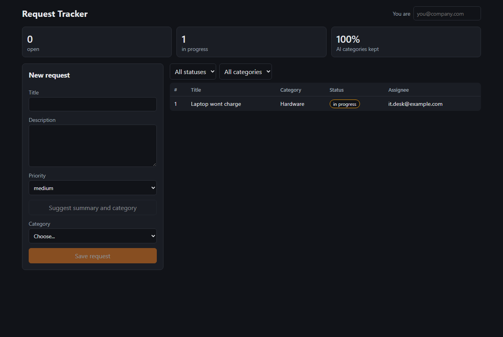
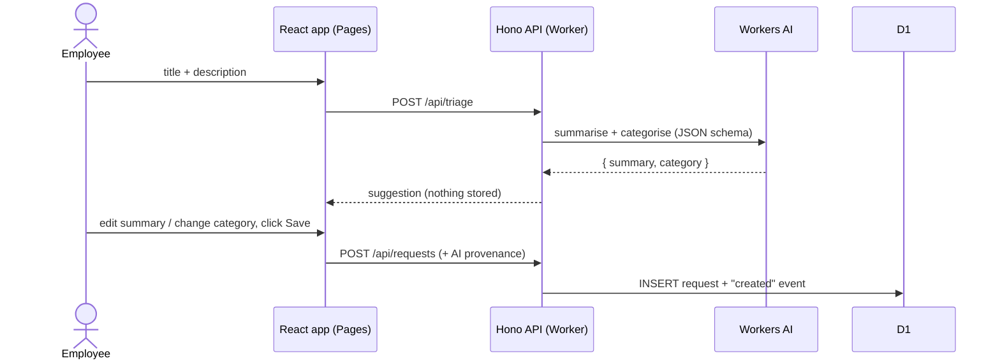

# Internal Request Tracker

A full-stack internal tool that runs entirely on Cloudflare's edge. Employees file
IT, facilities, HR and finance requests, and Workers AI drafts a one-line summary
and suggests a category. **A person reviews the suggestion and confirms before
anything is saved.** Every change after that is recorded in an audit trail.

**Live:** frontend at https://request-tracker-dwi.pages.dev, API at
https://request-tracker-api.request-tracker-api.workers.dev (deployed 2026-10-13).



## Live results

Measured against the deployed Worker on 2026-10-13 (`docs/live-triage-results.json`):

- **Workers AI triage:** 14 hand-written sample requests, 2 per category. The model
  picked the expected category for **14/14**. Latency for `POST /api/triage` measured from
  the client was **p50 1.2 s, max 2.0 s**. This is a small smoke test, not a benchmark.
- **End to end:** triage, then create, then PATCH status and assignee, all against the
  remote D1 database. The audit event and the AI provenance fields were stored, and
  `/api/stats` reported the suggested category as kept.
- **CORS:** a preflight from the Pages origin gets `Access-Control-Allow-Origin`. A
  request from any other origin gets no CORS header.

| Layer | Tech |
|---|---|
| API | TypeScript, [Hono](https://hono.dev) on Cloudflare Workers, zod validation |
| Data | Cloudflare D1 (SQLite) with versioned migrations |
| AI triage | Workers AI (`@cf/meta/llama-3.3-70b-instruct-fp8-fast`, JSON-schema output) |
| Frontend | React + Vite, deployed on Cloudflare Pages |
| Tests | Vitest: API integration tests in the Workers runtime against local D1, plus component tests |
| Delivery | Wrangler, run from GitHub Actions on every merge to `main` |



## How the AI step works

- `POST /api/triage` sends the title and description to Workers AI with a system prompt listing the allowed categories and a JSON schema for the response.
- The output is validated. The category must be one of the 7 known values, and the summary must be non-empty. The parser copes with models that wrap JSON in prose or code fences.
- **The triage endpoint never writes to D1.** The form shows the suggestion as editable fields. Only the explicit **Save request** click calls `POST /api/requests`.
- If the model is unreachable or returns something unusable, the API responds with `ai_available: false`. The form then asks the person to choose a category themselves and keeps Save disabled until they do.
- The saved row keeps what the model suggested (`ai_summary`, `ai_category`, `ai_model`) next to what the person chose. `GET /api/stats` reports how often the suggested category was kept, and the dashboard shows it as "AI categories kept".

## API

| Method | Path | |
|---|---|---|
| GET | `/api/health` | |
| GET | `/api/categories` | allowed categories |
| POST | `/api/triage` | `{ title, description }` → `{ summary, suggested_category, model, ai_available }` |
| GET | `/api/requests?status=&category=&limit=` | newest first |
| GET | `/api/requests/:id` | request plus its event history |
| POST | `/api/requests` | create (validated with zod) |
| PATCH | `/api/requests/:id` | change status / assignee / category / priority, `actor` required. Each change is written with its audit event in one D1 batch |
| GET | `/api/stats` | counts by status, AI acceptance |

CORS only allows origins listed in `ALLOWED_ORIGINS`.

## Run locally

```bash
cd api
npm install
npm run migrate:local
npx wrangler dev --env offline     # API on http://localhost:8787, no Cloudflare login needed
node scripts/seed.mjs              # optional sample data

cd ../web
npm install
npm run dev                        # http://localhost:5173
```

The `offline` environment has no AI binding, so triage takes the fallback path. To
try real AI suggestions locally, run `npx wrangler login` and then `npx wrangler dev`.
Workers AI always runs remotely, even in local dev.

## Tests

```bash
cd api && npm test     # 27 integration tests
cd web && npm test     # 4 component tests
```

The API tests use `@cloudflare/vitest-plugin`, so they run inside the real Workers
runtime (workerd) against a local D1 database with the migrations applied. They
call the Hono app through its routes, with a fake AI binding injected to control
model output. They cover:

- create, list, filter, get, update, and the audit events each produces
- validation errors for every field, and that nothing is written on a 400
- triage returning the model output, never touching D1, parsing messy model text, and falling back on unknown categories, missing fields, non-JSON output and thrown errors
- AI provenance and acceptance stats
- the CORS allow-list

The component tests check that the form shows the suggestion without saving,
saves only on confirm with the person's edits, and blocks saving without a category.

## Deploy

One-time setup:

```bash
cd api
npx wrangler login
npx wrangler d1 create request-tracker          # copy the database_id into wrangler.jsonc (both places)
npm run migrate:remote
npx wrangler deploy                             # note the *.workers.dev URL
cd ../web
VITE_API_URL=https://request-tracker-api.<you>.workers.dev npm run build
npx wrangler pages project create request-tracker --production-branch main
npm run deploy
```

Then add the Pages URL to `ALLOWED_ORIGINS` in `api/wrangler.jsonc`.

### Continuous deployment

`.github/workflows/ci-deploy.yml` runs the API typecheck and tests, and the web
tests and build, on every push and pull request. On a push to `main` (every
merge), it applies D1 migrations, deploys the Worker with Wrangler and deploys the
frontend to Pages. To enable it, add these in the GitHub repo settings:

- secrets `CLOUDFLARE_API_TOKEN` (Workers, D1, Pages and Workers AI edit permissions) and `CLOUDFLARE_ACCOUNT_ID`
- variables `DEPLOY_ENABLED=true` and `API_URL=https://request-tracker-api.<you>.workers.dev`

`CLOUDFLARE_ACCOUNT_ID` and `API_URL` are set on this repo. The deploy job stays off
until `CLOUDFLARE_API_TOKEN` and `DEPLOY_ENABLED=true` are added. The live deployment
above was made with the same Wrangler commands, run by hand.

## Production notes

- Put the Pages site and the API behind **Cloudflare Access** so only employees can reach them. The API can then read the signed-in user from `Cf-Access-Authenticated-User-Email` instead of the "You are" field.
- D1 migrations live in `api/migrations` and are applied before each deploy, so the schema and the code ship together.
